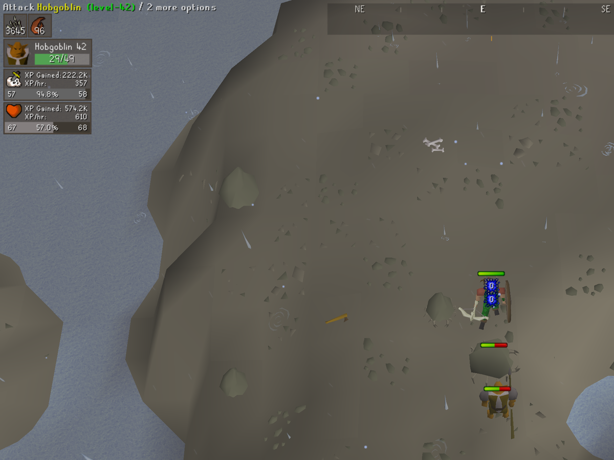
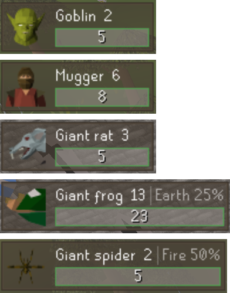

# Foe

The monster you're fighting, at a glance.

One small panel for your current target: its name and combat level, an HP bar, its combat stats, and
the element it's weak to. It appears when you attack and clears when the monster dies. It works
offline, and it never invents a number. Before your first hit you see only the monster's max HP, and
a weakness shows only when the game or the bundled table says what it is.

## What it shows

- **HP.** Exact when Foe has seen every hit since the monster was at full health. Otherwise it's the
  middle of the range the health bar allows. Before your first hit, the bar is an empty outline with
  the max HP alone.
- **Combat levels.** The combat level beside the name, and with Detail set to Full the Attack,
  Strength, Defence, Ranged and Magic levels. Levels of 1 or less are left out.
- **Elemental weakness.** From a table built from the OSRS Wiki, for example *Fire 50%*. When one of
  your spells lands, the game reports the weakness and Foe remembers it, and a reported element wins
  over a different one in the table. A monster with no weakness shows nothing.
- **Portrait.** A small picture of the monster's head, drawn from its own models:
  its chathead when it has one, otherwise the head of its body model, seen from the side for a
  creature on all fours, and from above for a spider-shaped one.

*Portraits, top to bottom: two chatheads, a rat and a frog from the side, a spider from above.*

### How it behaves

- **Follows your attack.** The panel picks up the monster you click *Attack* on or cast a spell at,
  or the one that hits you. Talking to an NPC never brings it up.
- **Sticks in multi-combat.** Hitting or being hit by another monster doesn't steal the panel while
  you're still fighting your target.
- **After the health bar goes.** The last known HP stays on the panel, drawn faded or hollow so it's
  clearly not live, until the panel lingers out.
- **Clears on death.** At once, whatever the linger setting.
- **Holds still.** Nothing in the panel moves or resizes as HP changes.

## Settings

| Setting | Default | What it does |
|---|---|---|
| Layout | Stacked | *Stacked* puts the bar under the name; *One line* puts everything on one strip |
| HP text | Current/max | *Current/max*, *Current*, *Percent* or *None* |
| HP text position | Inside bar | *Inside bar*, where the bar widens if the text needs it, or *Beside bar* |
| Detail | Compact | *Compact* is name, HP and weakness; *Full* adds Attack, Strength, Defence, Ranged and Magic |
| Stale HP style | Faded | How HP looks once the health bar has gone: *Faded* (half opacity) or *Hollow* (outline only) |
| Show weakness | On | The elemental weakness, when one is known |
| Show weakness % | On | The percentage beside it, for example *Fire 50%* |
| Linger after combat | 10 s | How long the panel stays after the last sign of combat (0 to 60). Very short values can flicker between hits |
| Background opacity | 61% | RuneLite's standard overlay background; 0% draws the text alone |
| Show portrait | On | A small picture of the monster's head, left of its name |

*Layout: Stacked, then One line.*

*HP text: Current/max, Current, Percent, then Beside bar.*

*Stale HP style: Faded, then Hollow.*

## Works with

**Opponent Info**, RuneLite's built-in overlay, shows a monster's HP too, so with both on you'll see it
twice. Opponent Info also covers player opponents, which Foe doesn't, so keep it on if you fight
other players.

## What it doesn't do

It only draws. It never clicks, moves your camera, or sends anything to the game, and it makes no
network calls: the weakness table ships with the plugin.

## Building

Needs Java 11. Run `./gradlew build` to build and test, or `./gradlew run` to launch a development
client with the plugin loaded.

## Credits

Foe's elemental weakness table (`src/main/resources/com/foe/weakness-table.tsv`) is derived from the
[Old School RuneScape Wiki](https://oldschool.runescape.wiki), whose content is licensed under
[CC BY-NC-SA 3.0](https://creativecommons.org/licenses/by-nc-sa/3.0/). The table carries its own notice,
[`weakness-table.LICENSE`](src/main/resources/com/foe/weakness-table.LICENSE), and the wiki's editors are credited
through each page's history.

## License

The plugin code: BSD 2-Clause, see [LICENSE](LICENSE). The weakness table: CC BY-NC-SA 3.0, as above.
